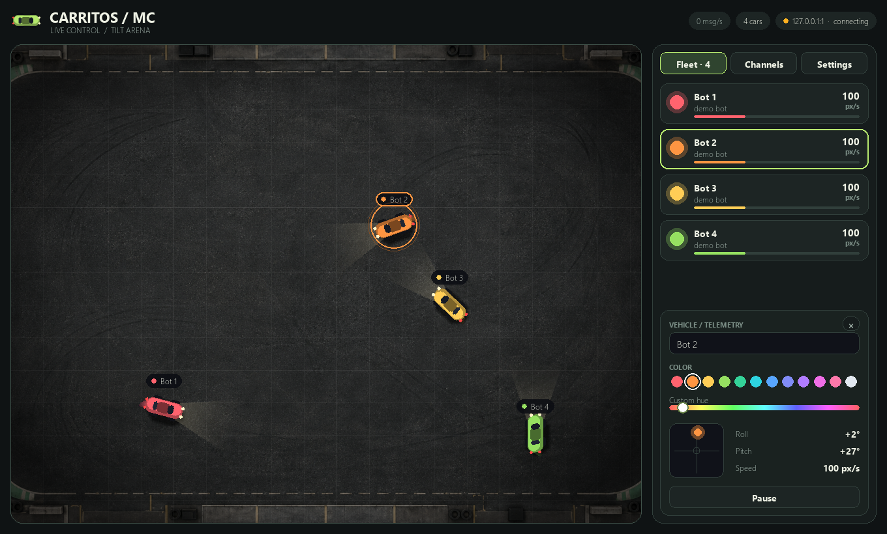
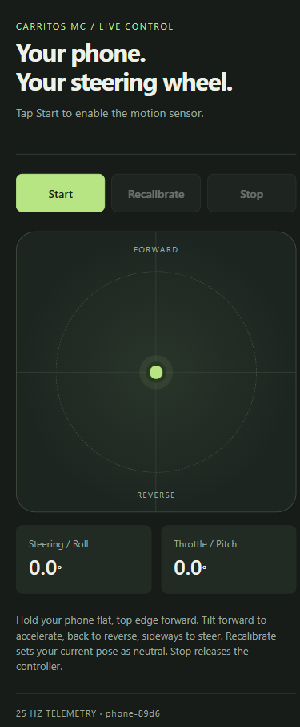

# Carritos MC

[](https://github.com/yughiyami/carritos-mc/actions/workflows/ci.yml)


**Arena de carritos sin carriles controlados por inclinación.** Cada ESP32 (o celular) que publique su inclinación por MQTT se convierte en un carrito dentro de una arena de escritorio. Sin límite de carritos ni de canales MQTT, y con un panel de control integrado para renombrarlos, cambiarles el color, pausarlos o expulsarlos.

[Read in English](README.md)


## Características

- **Cualquier cantidad de carritos.** Un carrito aparece con su primer mensaje MQTT y desaparece cuando el dispositivo se desconecta o pasa 3 s sin enviar nada.
- **Canales en vivo.** Escuchá todos los prefijos de tópico MQTT que quieras y agregalos o quitalos mientras corre el programa, desde el panel. El mismo id en dos canales da dos carritos.
- **Panel de control.** Renombrá carritos, elegí color (paleta o slider de matiz libre), pausalos, expulsá (bloqueá) un dispositivo y mirá en vivo su roll/pitch y velocidad. Nombres y colores se recuerdan por dispositivo.
- **Tres tipos de control:** un ESP32 + MPU6050 (firmware incluido), un celular (una página web, sin instalar apps) y un simulador integrado. También hay bots de demostración y un carrito de teclado dentro de la app, para probar todo sin hardware.
- **Sensación ajustable.** Ángulo de inclinación máxima, zona muerta y velocidad máxima son sliders.
- **Liviano.** Alrededor de 3 ms por frame con 6 carritos (medido sin ventana en la máquina de desarrollo).

## Cómo funciona

```
 ESP32 + MPU6050 ──┐
                   │  {"roll":..,"pitch":..}        ┌──────────────────┐
 Celular (HTTPS) ───┼──► phone_bridge ──► MQTT ───► │ broker (Mosquitto)│
                   │                                └────────┬─────────┘
 Simulador ────────┘                                         │
                                                             ▼
                                              arena carritos (pygame)
```

Inclinar hacia adelante o atrás = acelerar o retroceder. Inclinar a los costados = girar. No hay carriles: los carritos recorren una arena que se "envuelve" en los bordes y chocan entre sí.

## Inicio rápido (sin hardware ni broker)

```bash
git clone https://github.com/yughiyami/carritos-mc.git
cd carritos-mc
python -m venv .venv
.venv\Scripts\activate          # Linux/macOS: source .venv/bin/activate
pip install -r requirements.txt
python -m carritos --bots 4
```

Se abre la ventana con cuatro bots. Hacé clic en un carrito (o en una tarjeta del panel) para personalizarlo. La barra superior dice `connecting` hasta que haya un broker accesible; los bots y el carrito de teclado funcionan igual.

## Instalación completa

### 1. Broker MQTT

Instalá [Mosquitto](https://mosquitto.org/download/) y ejecutalo con la configuración incluida, que abre el puerto 1883 a tu red local:

```bash
mosquitto -c mosquitto.conf -v
```

Con Docker:

```bash
docker run --rm -p 1883:1883 -v "$PWD/mosquitto.conf:/mosquitto/config/mosquitto.conf" eclipse-mosquitto
```

> `mosquitto.conf` permite conexiones anónimas: sirve para una red casera o de laboratorio de confianza. En cualquier otro caso, configurá autenticación y pasá `--user/--password` a cada componente.

En Windows, permití el broker (puerto 1883) en el firewall para redes privadas, así los ESP32 pueden alcanzarlo.

### 2. La arena

```bash
python -m carritos                                  # broker en localhost, canal "carritos"
python -m carritos --host 192.168.1.50              # broker en otra máquina
python -m carritos -c carritos -c garage/carritos   # varios canales a la vez
```

### 3. Controles

Elegí uno o mezclalos.

| Control | Cómo |
|---|---|
| **ESP32 + MPU6050** | Cargá [`firmware/carrito_esp32`](firmware/carrito_esp32/carrito_esp32.ino), ver [Firmware del ESP32](#firmware-del-esp32) |
| **Celular** | `python -m carritos.phone_bridge` y abrí en el celular la dirección `https://` que imprime |
| **Simulador** | `python -m carritos.simulator --cars 5` |
| **Bots / carrito de teclado** | En el panel: Settings → Demo (sin broker) |

## Uso de la arena

El panel de la derecha tiene tres pestañas.

**Fleet** lista todos los carritos con su velocidad. Hacé clic en una tarjeta (o en el carrito dentro de la arena) para abrir el inspector:

- **Nombre**: escribí para renombrar (hasta 20 caracteres). Se guarda por dispositivo.
- **Color**: 12 colores predefinidos o el slider arcoíris. Se guarda por dispositivo.
- **Pad de inclinación en vivo**: un punto muestra el roll/pitch actual y el cuadrado pequeño es la zona muerta.
- **Pause / Resume** congela un carrito en su lugar.
- **Kick** expulsa un dispositivo y lo ignora hasta que lo desbloquees (pestaña Channels).

**Channels** muestra la conexión con el broker y la tasa de mensajes, los canales suscritos y cuántos carritos tiene cada uno. Escribí un prefijo de tópico (por ejemplo `garage/carritos`) y presioná **Add**; con **×** dejás de escucharlo y se quitan los carritos de ese canal. Los dispositivos expulsados aparecen al final con un botón **Unblock**.

**Settings**:

| Ajuste | Efecto |
|---|---|
| Full-tilt angle | Inclinación que da el 100 % de aceleración o giro. Menor = más sensible |
| Dead zone | Inclinación que se ignora alrededor del neutro |
| Top speed | Velocidad máxima hacia adelante en px/s |
| Glowing trails, Name tags, Arena grid | Opciones visuales |
| Demo bots | Carritos con movimiento programado, útiles para probar |
| Keyboard car | Un carrito que manejás con **WASD** o las flechas |
| Scatter cars | Reubica a todos en posiciones al azar |

| Tecla | Acción |
|---|---|
| `Tab` | Ocultar / mostrar el panel |
| `F11` | Pantalla completa |
| `Esc` | Salir (si estás escribiendo, primero suelta el foco) |

Los ajustes, canales y los nombres/colores por dispositivo se guardan en `~/.carritos-mc/profile.json`.

 

## Firmware del ESP32

**Materiales:** cualquier placa ESP32 + un módulo MPU6050 (GY-521).

| MPU6050 | ESP32 |
|---|---|
| VCC | 3V3 |
| GND | GND |
| SDA | GPIO 21 |
| SCL | GPIO 22 |

**Cargarlo:**

1. En el Arduino IDE instalá el paquete de placas ESP32 y la librería **PubSubClient**.
2. Abrí `firmware/carrito_esp32/carrito_esp32.ino` y completá `WIFI_SSID`, `WIFI_PASS` y `MQTT_HOST` (la IP de la PC que corre el broker). Opcionalmente `TOPIC_PREFIX` (el canal) y `CAR_NAME`.
3. Subilo. El monitor serie (115200) imprime el id del carrito, por ejemplo `esp32-3f1c`, y `MQTT connected`.

**Orientación.** Montá el sensor plano con los ejes impresos: X hacia adelante, Y a la izquierda, Z hacia arriba. Si un carrito gira o acelera al revés, invertí `SIGN_ROLL` o `SIGN_PITCH` en el sketch. El ESP32 en sí no trae acelerómetro; algunas placas (M5StickC, T-Watch...) sí, pero requieren un pequeño cambio de firmware.

## Celular como control

```bash
python -m carritos.phone_bridge --host 192.168.1.50
```

1. Abrí en un celular conectado a la misma WiFi la dirección `https://<ip-de-la-pc>:8443/` que imprime el programa.
2. Aceptá la advertencia del certificado una sola vez (el puente genera un certificado autofirmado en `~/.carritos-mc/certs`). HTTPS es obligatorio: los navegadores móviles ocultan los sensores de movimiento en HTTP plano.
3. Tocá **Start** (en iOS, permití el acceso al movimiento), sostené el celular plano como una bandeja con el borde superior apuntando hacia adelante y tocá **Zero**.

El celular aparece como `phone-xxxx`. Usá `--prefix` para publicar en otro canal y `--https-port` para cambiar el puerto. Si la página no carga, abrí ese puerto en el firewall.

## Contrato MQTT

Todo sigue el formato `<canal>/<id>/<tipo>`. El canal por defecto es `carritos`.

| Tópico | Payload | Notas |
|---|---|---|
| `<canal>/<id>/tilt` | `{"roll": grados, "pitch": grados}` | ~25 Hz. `pitch` + = adelante, `roll` + = derecha |
| `<canal>/<id>/status` | `online` / `offline` | Retenido. Publicá `offline` como Last Will de MQTT |

- Los canales usan letras, números, `-` y `_`, y pueden anidarse con `/` (máx. 48 caracteres).
- Sirve cualquier dispositivo que respete este contrato, no solo el firmware incluido. Por ejemplo:

  ```bash
  mosquitto_pub -h localhost -t carritos/mi-dispositivo/tilt -m '{"roll": 20, "pitch": 25}'
  ```

## Opciones

`python -m carritos`

| Opción | Por defecto | Descripción |
|---|---|---|
| `--host`, `--port` | `localhost`, `1883` | Broker MQTT |
| `--user`, `--password` | ninguno | Credenciales del broker |
| `-c`, `--channel` | perfil guardado, si no `carritos` | Prefijo de tópico a escuchar. Repetible |
| `--bots N` | `0` | Arrancar con N bots de demostración |
| `--profile RUTA` | `~/.carritos-mc/profile.json` | Dónde se guardan nombres, colores y ajustes |
| `--width`, `--height` | `1360`, `820` | Tamaño inicial de la ventana (redimensionable) |

`python -m carritos.phone_bridge`: `--host`, `--port`, `--user`, `--password`, `--prefix`, `--https-port`.
`python -m carritos.simulator`: `--cars`, `--host`, `--port`, `--user`, `--password`, `--prefix`, `--rate`.

## Solución de problemas

| Síntoma | Qué revisar |
|---|---|
| La barra superior dice `connecting` / `reconnecting` | Broker apagado, `--host` incorrecto o firewall en el puerto 1883 |
| El ESP32 imprime `MQTT connected` pero no aparece el carrito | El `TOPIC_PREFIX` del sketch debe ser uno de los canales de la pestaña **Channels** |
| Un carrito desaparece a los pocos segundos | El dispositivo dejó de publicar (timeout de 3 s); revisá WiFi y alimentación |
| Un dispositivo expulsado no vuelve | Está bloqueado: pestaña Channels → **Unblock** |
| La página del celular abre pero no muestra datos | La URL debe ser `https://`; tocá **Start** y permití el acceso al movimiento |
| El celular no puede abrir la página | ¿Misma WiFi? ¿El firewall de Windows permite Python en redes privadas? |
| El giro o la aceleración están invertidos | Invertí `SIGN_ROLL` / `SIGN_PITCH` en el firmware (en la página del celular, tocá **Zero** para reiniciar la pose neutra) |
| Muy nervioso o muy lento | Settings → Full-tilt angle y Dead zone |

## Desarrollo

```bash
pip install -r requirements.txt pytest
python -m pytest
```

Los tests corren sin ventana ni broker. Estructura:

```
carritos/
  core.py          lógica pura: mapeo de inclinación, física, flota, ruteo MQTT (sin pygame/MQTT)
  link.py          cliente MQTT con canales en vivo
  app.py           ventana, layout, panel de control
  render.py        dibujo de la arena
  ui.py            pequeño kit de widgets + tema
  profile.py       nombres, colores, canales y ajustes guardados
  phone_bridge.py  página HTTPS -> MQTT
  simulator.py     ESP32 simulados
  web/             página del control por celular
firmware/          sketch del ESP32
tests/
```

## Diseño y controles renovados

La arena usa una imagen de asfalto generada con el modelo de imágenes, incluida localmente: no necesita red ni claves API. **B** activa o desactiva los bots; **K** activa o desactiva el carrito de teclado; **Tab** muestra u oculta el panel. El panel se adapta a ventanas pequeñas y permite desplazar el inspector. Los atajos de conducción no interfieren mientras escribís en un campo.

El control del celular incluye **Stop** (detener) y **Recalibrate** (recalibrar). Al iniciar, la primera lectura establece la posición neutra. Detener u ocultar la página libera el control. Si faltan lecturas del sensor, envía valores neutros; las solicitudes de red trabadas caducan y se reintentan. El sensor sigue necesitando el puente HTTPS y permiso del dispositivo.




Las pruebas del script del navegador necesitan Node.js (`node tests/phone_controller.test.cjs`); pytest las ejecuta automáticamente si Node está instalado. CI instala Node para no omitirlas.

## Licencia

[MIT](LICENSE)
