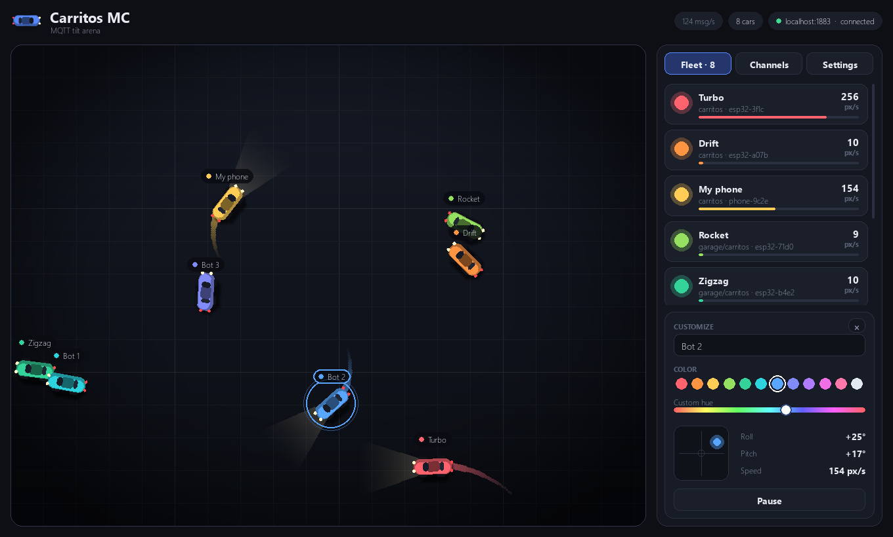
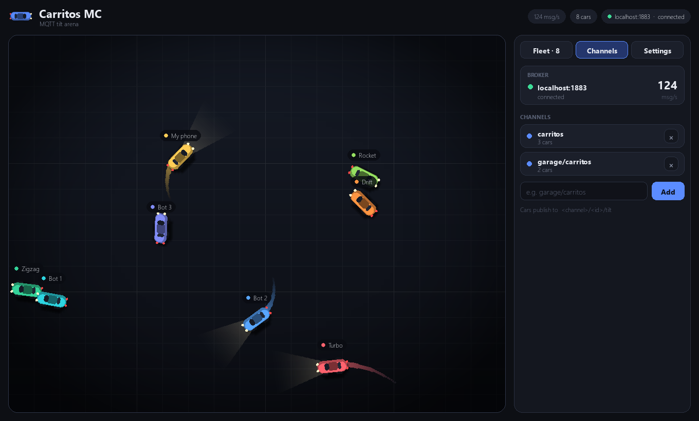
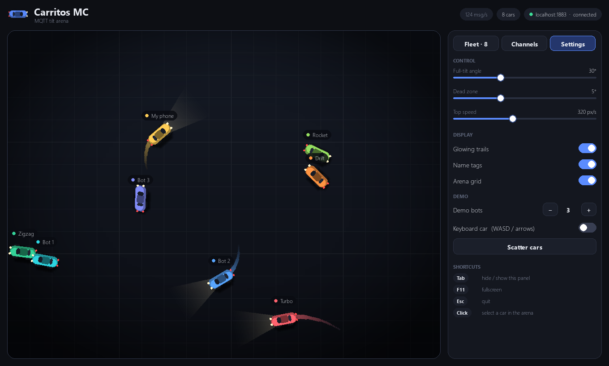

# Carritos MC

[](https://github.com/yughiyami/carritos-mc/actions/workflows/ci.yml)


**Lane-free multi-car arena driven by tilt.** Every ESP32 (or phone) that publishes its tilt over MQTT becomes a car in a desktop arena. Any number of cars, any number of MQTT channels, with a built-in control panel to rename, recolor, pause or kick them.

[Leer en español](README.es.md)



## Features

- **Any number of cars.** A car appears on its first MQTT message and disappears when the device goes offline or stays silent for 3 s.
- **Live channels.** Listen on as many MQTT topic prefixes as you want and add or remove them at runtime from the panel. The same device id on two channels gives two cars.
- **Control panel.** Rename cars, pick a color (palette or free hue slider), pause, kick (block) a device, watch live roll/pitch and speed. Names and colors are remembered per device.
- **Three kinds of controllers:** an ESP32 + MPU6050 (firmware included), a phone (a web page, no app to install) and a built-in simulator. There are also in-app demo bots and a keyboard car, so you can try everything without hardware.
- **Tunable feel.** Full-tilt angle, dead zone and top speed are sliders.
- **Light on the CPU.** Roughly 3 ms per frame with 6 cars (measured headless on the dev machine).

## How it works

```
 ESP32 + MPU6050 ──┐
                   │  {"roll":..,"pitch":..}        ┌──────────────────┐
 Phone (HTTPS page)─┼──► phone_bridge ──► MQTT ───► │ broker (Mosquitto)│
                   │                                └────────┬─────────┘
 Simulator ────────┘                                         │
                                                             ▼
                                              carritos arena (pygame)
```

Tilt forward/back = throttle/reverse. Tilt left/right = steer. There are no lanes: cars roam a wrap-around arena and bump into each other.

## Quick start (no hardware, no broker)

```bash
git clone https://github.com/yughiyami/carritos-mc.git
cd carritos-mc
python -m venv .venv
.venv\Scripts\activate          # Linux/macOS: source .venv/bin/activate
pip install -r requirements.txt
python -m carritos --bots 4
```

The window opens with four demo bots. Click a car (or a card in the panel) to customize it. The top bar says `connecting` until a broker is reachable; the bots and the keyboard car work regardless.

## Full setup

### 1. MQTT broker

Install [Mosquitto](https://mosquitto.org/download/) and run it with the bundled config, which opens port 1883 to your LAN:

```bash
mosquitto -c mosquitto.conf -v
```

With Docker instead:

```bash
docker run --rm -p 1883:1883 -v "$PWD/mosquitto.conf:/mosquitto/config/mosquitto.conf" eclipse-mosquitto
```

> `mosquitto.conf` allows anonymous connections: fine on a trusted home or lab network. On anything else, configure authentication and pass `--user/--password` to every component.

Windows: allow the broker (port 1883) through the firewall for private networks so ESP32s can reach it.

### 2. The arena

```bash
python -m carritos                                  # broker on localhost, channel "carritos"
python -m carritos --host 192.168.1.50              # broker on another machine
python -m carritos -c carritos -c garage/carritos   # several channels at once
```

### 3. Controllers

Pick any, or mix them.

| Controller | How |
|---|---|
| **ESP32 + MPU6050** | Flash [`firmware/carrito_esp32`](firmware/carrito_esp32/carrito_esp32.ino), see [ESP32 firmware](#esp32-firmware) |
| **Phone** | `python -m carritos.phone_bridge`, then open the printed `https://` address on the phone |
| **Simulator** | `python -m carritos.simulator --cars 5` |
| **Demo bots / keyboard car** | In the panel: Settings → Demo (no broker needed) |

## Using the arena

The panel on the right has three tabs.

**Fleet** lists every car with its speed. Click a card (or the car itself in the arena) to open the inspector:

- **Name**: type to rename (up to 20 characters). Saved per device.
- **Color**: 12 presets or the rainbow slider. Saved per device.
- **Live tilt pad**: a dot shows the current roll/pitch, the small square is the dead zone.
- **Pause / Resume** freezes a car in place.
- **Kick** removes a device and ignores it until you unblock it (Channels tab).

**Channels** shows the broker connection and message rate, the subscribed channels and how many cars each has. Type a topic prefix (for example `garage/carritos`) and press **Add**; use **×** to stop listening and drop that channel's cars. Kicked devices are listed at the bottom with an **Unblock** button.

**Settings**:

| Setting | Effect |
|---|---|
| Full-tilt angle | Tilt that gives 100 % throttle/steering. Lower = more sensitive |
| Dead zone | Tilt ignored around neutral |
| Top speed | Maximum forward speed in px/s |
| Glowing trails, Name tags, Arena grid | Display toggles |
| Demo bots | Scripted cars, handy to try the arena |
| Keyboard car | A car you drive with **WASD** or the arrow keys |
| Scatter cars | Re-spawn everyone at random spots |

| Key | Action |
|---|---|
| `Tab` | Hide / show the panel |
| `F11` | Fullscreen |
| `Esc` | Quit (first drops focus if you are typing) |

Settings, channels, and per-device names/colors are saved to `~/.carritos-mc/profile.json`.

 

## ESP32 firmware

**Parts:** any ESP32 dev board + an MPU6050 (GY-521) module.

| MPU6050 | ESP32 |
|---|---|
| VCC | 3V3 |
| GND | GND |
| SDA | GPIO 21 |
| SCL | GPIO 22 |

**Flash:**

1. In the Arduino IDE install the ESP32 board package and the **PubSubClient** library.
2. Open `firmware/carrito_esp32/carrito_esp32.ino` and set `WIFI_SSID`, `WIFI_PASS` and `MQTT_HOST` (the IP of the PC running the broker). Optionally set `TOPIC_PREFIX` (the channel) and `CAR_NAME`.
3. Upload. The serial monitor (115200) prints the car id, e.g. `esp32-3f1c`, and `MQTT connected`.

**Orientation.** Mount the sensor flat with its printed axes as X forward, Y left, Z up. If a car steers or accelerates the wrong way, flip `SIGN_ROLL` or `SIGN_PITCH` in the sketch. The ESP32 itself has no accelerometer; some boards (M5StickC, T-Watch...) do, but need a small firmware change.

## Phone controller

```bash
python -m carritos.phone_bridge --host 192.168.1.50
```

1. Open the printed `https://<pc-ip>:8443/` on a phone connected to the same WiFi.
2. Accept the certificate warning once (the bridge generates a self-signed certificate in `~/.carritos-mc/certs`). HTTPS is mandatory: mobile browsers hide motion sensors on plain HTTP.
3. Tap **Start** (allow motion access on iOS), hold the phone flat like a tray with the top edge pointing forward, and tap **Zero**.

The phone shows up as `phone-xxxx`. Use `--prefix` to publish on another channel and `--https-port` to change the port. Open the firewall for that port if the page does not load.

## MQTT contract

Everything is `<channel>/<id>/<kind>`. The default channel is `carritos`.

| Topic | Payload | Notes |
|---|---|---|
| `<channel>/<id>/tilt` | `{"roll": deg, "pitch": deg}` | ~25 Hz. `pitch` + = forward, `roll` + = right |
| `<channel>/<id>/status` | `online` / `offline` | Retained. Publish `offline` as the MQTT Last Will |

- Channels are letters, numbers, `-` and `_`, optionally nested with `/` (max 48 chars).
- Any device that follows this contract works, not only the ESP32 firmware here. For example:

  ```bash
  mosquitto_pub -h localhost -t carritos/my-device/tilt -m '{"roll": 20, "pitch": 25}'
  ```

## Options

`python -m carritos`

| Option | Default | Description |
|---|---|---|
| `--host`, `--port` | `localhost`, `1883` | MQTT broker |
| `--user`, `--password` | none | Broker credentials |
| `-c`, `--channel` | saved profile, else `carritos` | Topic prefix to listen on. Repeatable |
| `--bots N` | `0` | Start with N demo bots |
| `--profile PATH` | `~/.carritos-mc/profile.json` | Where names, colors and settings are saved |
| `--width`, `--height` | `1360`, `820` | Initial window size (resizable) |

`python -m carritos.phone_bridge`: `--host`, `--port`, `--user`, `--password`, `--prefix`, `--https-port`.
`python -m carritos.simulator`: `--cars`, `--host`, `--port`, `--user`, `--password`, `--prefix`, `--rate`.

## Troubleshooting

| Symptom | Check |
|---|---|
| Top bar says `connecting` / `reconnecting` | Broker not running, wrong `--host`, or firewall on port 1883 |
| The ESP32 prints `MQTT connected` but no car appears | The sketch's `TOPIC_PREFIX` must be one of the channels in the **Channels** tab |
| A car disappears after a few seconds | The device stopped publishing (3 s timeout); check WiFi and power |
| A kicked device does not come back | It is blocked: Channels tab → **Unblock** |
| The phone page opens but shows no data | The URL must be `https://`; tap **Start** and allow motion access |
| Phone cannot open the page | Same WiFi? Windows firewall allowing Python on private networks? |
| Steering or throttle feels inverted | Flip `SIGN_ROLL` / `SIGN_PITCH` in the firmware (on the phone page, tap **Zero** to reset the neutral pose) |
| Too twitchy or too sluggish | Settings → Full-tilt angle and Dead zone |

## Development

```bash
pip install -r requirements.txt pytest
python -m pytest
```

The tests run headless (no window, no broker). Layout:

```
carritos/
  core.py          pure logic: tilt mapping, physics, fleet, MQTT routing (no pygame/MQTT imports)
  link.py          MQTT client with live channels
  app.py           window, layout, control panel
  render.py        arena drawing
  ui.py            small immediate-mode widget kit + theme
  profile.py       saved names, colors, channels, settings
  phone_bridge.py  HTTPS page -> MQTT
  simulator.py     fake ESP32s
  web/             phone controller page
firmware/          ESP32 sketch
tests/
```

## License

[MIT](LICENSE)
